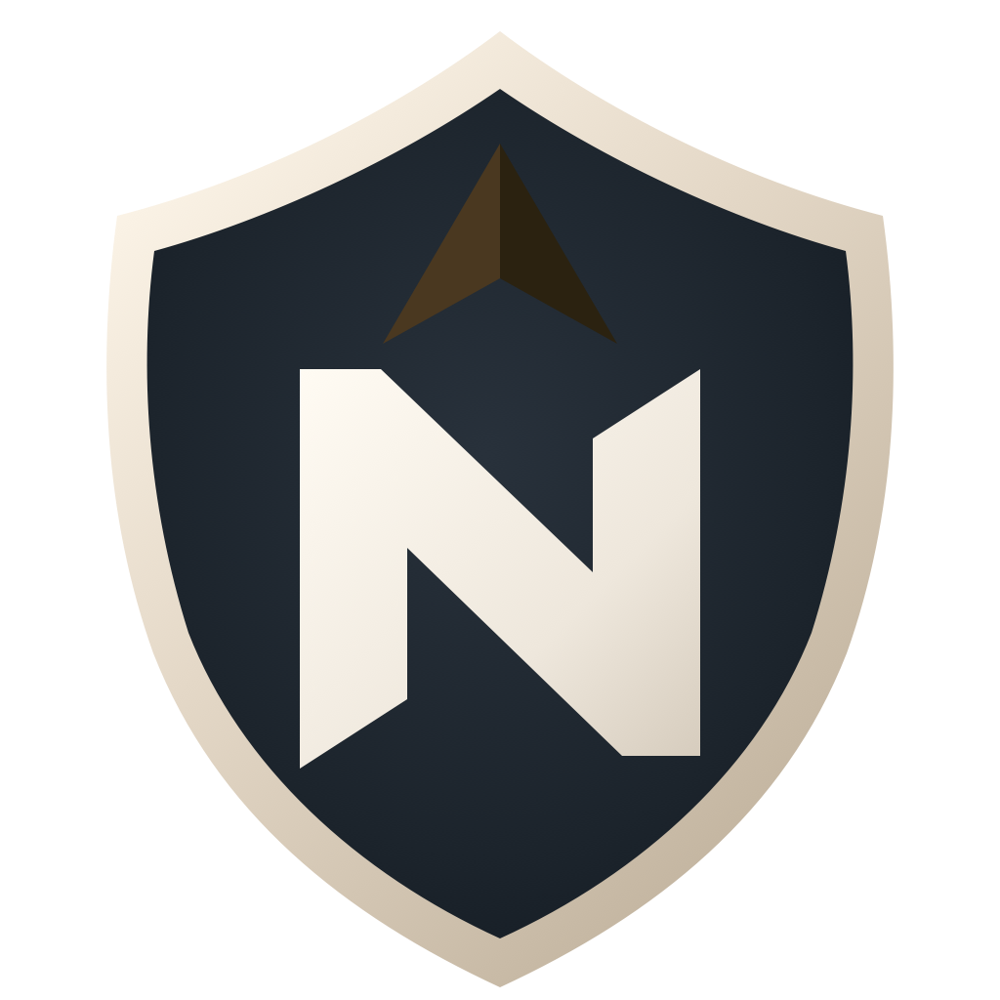
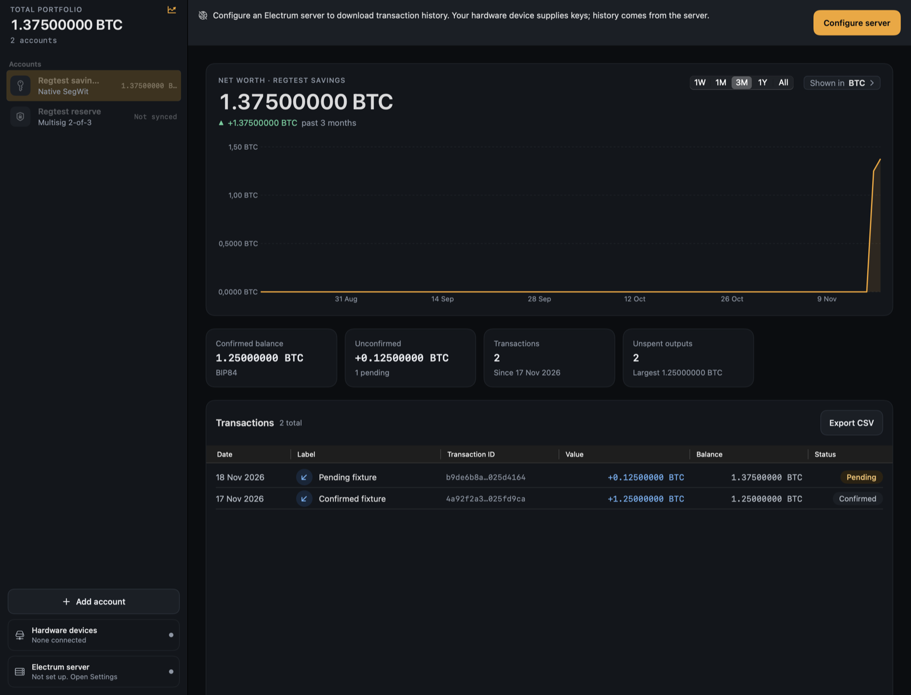

<p align="center">
  
</p>

<h1 align="center">Northvault</h1>

<p align="center">
  A native, watch-only Bitcoin wallet for macOS.<br>
  Your keys stay on your hardware wallet. Northvault never sees them.
</p>

<p align="center">
  <a href="https://github.com/ghostkommit/northvault/actions/workflows/ci.yml"></a>
  <a href="https://github.com/ghostkommit/northvault/releases/latest"></a>
  
</p>

<p align="center">
  
</p>

> [!WARNING]
> **Pre-release software.** Northvault was written with AI assistance and has not had an
> independent security audit. Hardware wallet support has not been fully validated on
> physical devices. Try it with test networks or small amounts, and always confirm
> addresses and amounts on your device's own screen. See [SECURITY.md](SECURITY.md).

## What it does

- **Watch-only by design.** Northvault holds public keys only. It builds unsigned
  transactions (PSBTs); your **Coldcard, Trezor or Jade** signs them. Seed phrases and
  private keys are refused wherever a file or text can be imported.
- **Single-sig and multisig.** Legacy, nested SegWit, native SegWit and Taproot
  single-sig accounts, plus M-of-N `sortedmulti` multisig vaults with up to 15 keys.
- **Three ways to sign.** USB, SD-card PSBT files, or animated QR codes scanned with
  your Mac's camera for fully air-gapped signers.
- **Verify before you trust.** Receive addresses can be shown on your device and are
  checked against what Northvault derived. Every signed transaction is checked against
  the draft you reviewed before it can be broadcast.
- **Coin control and fee safety.** Pick the exact coins to spend, send the maximum, and
  get warned about unusually high fees before anything is signed.
- **Standard formats.** Wallets move to and from other descriptor wallets using standard files, with
  the same derivation defaults.
- **Private by default.** No accounts, no telemetry, no third-party address lookups.
  The only server Northvault talks to is the Electrum server you choose.
- **Encrypted descriptor backups.** Optionally keep an encrypted copy of a wallet's
  descriptor in iCloud Drive so any one of its signers can recover the watch-only wallet.

## Install

1. Download `Northvault-<version>-macos-arm64.zip` from the
   [latest release](https://github.com/ghostkommit/northvault/releases/latest)
   (Apple Silicon, macOS 14 or later).
2. Optionally check the download against the published checksum:

   ```sh
   shasum -a 256 -c Northvault-<version>-macos-arm64.zip.sha256
   ```

3. Unzip it and move **Northvault.app** to your Applications folder.
4. Release builds are not yet notarized by Apple, so macOS blocks the first launch.
   Open **System Settings → Privacy & Security** and choose **Open Anyway**, or run:

   ```sh
   xattr -dr com.apple.quarantine /Applications/Northvault.app
   ```

Prefer to build it yourself? See [Build from source](#build-from-source).

## Getting started

1. **Choose a server.** Open **Settings** (⌘,) and pick your network and Electrum server
   (`ssl://host:50002`). Mainnet defaults to a public server; a public server learns
   your addresses, so use your own Electrum, electrs or Fulcrum server if you can.
2. **Add an account.** Click **Add account**, choose how many keys and signatures the
   wallet needs, then read each key from a connected device or import it from a file.
   Compare the first addresses with your device before saving.
3. **Receive.** Open **Receive**, then **Verify on device** so the address on your
   hardware wallet's screen matches the one in the app.
4. **Send.** Open **Send**, enter the address, amount and fee, and review the summary.
   Sign over USB, by file, or by QR code, then confirm the broadcast.

Curious before connecting anything? **Settings → Show sample wallet** opens read-only
demo data.

## Hardware wallets

| | Coldcard | Jade | Trezor |
|---|:---:|:---:|:---:|
| Connect | USB, SD card | USB, QR | USB |
| Read account key | ✓ | ✓ | ✓ |
| Verify address on device | ✓ ¹ | ✓ | ✓ |
| Sign single-sig | ✓ | ✓ | ✓ |
| Sign multisig | ✓ | ✓ ² | ✓ |

¹ Not for Taproot over USB. ² After registering the wallet on the device.

Any signer that reads and writes PSBT files or `crypto-psbt` animated QR codes
(Keystone, Passport, SeedSigner and others) can be used air-gapped.

## Compatible formats

| Format | Import | Export |
|---|:---:|:---:|
| Output descriptor (BIP389, Bitcoin Core) | ✓ | ✓ |
| Multisig setup file (Coldcard, Jade, Keystone, Passport) | ✓ | ✓ |
| BSMS descriptor record (BIP129) | ✓ | ✓ |
| Specter DIY wallet file (`addwallet`) | ✓ | ✓ |
| Coldcard, Cobo Vault or Keystone keystore JSON | ✓ | – |
| Jade / Keystone single-sig key descriptor | ✓ | – |
| Key expression `[fingerprint/path]xpub` | ✓ | – |
| Labels (BIP329) | ✓ | ✓ |
| PSBT file, binary or base64 | ✓ | ✓ |
| Animated QR PSBT (BC-UR) | ✓ | ✓ |

## Security at a glance

- Signing happens only on your hardware wallet. Unlocking an encrypted backup never
  authorizes spending.
- Imported files, QR codes, PSBTs, device responses and server responses are all
  treated as untrusted and validated before use.
- Change is recognized from your wallet's own descriptor, not from labels in a file.
- Limitations and the recovery model are described in [SECURITY.md](SECURITY.md).
  Please report vulnerabilities privately through
  [GitHub security advisories](https://github.com/ghostkommit/northvault/security/advisories/new).

## Build from source

Requires macOS 14+, Apple's Command Line Tools and [rustup](https://rustup.rs).

```sh
git clone https://github.com/ghostkommit/northvault.git
cd northvault
make run        # build and launch macos/build/Northvault.app
```

`make help` lists every target. Tests, linting, coverage and the Xcode workflow are
covered in [DEVELOPMENT.md](DEVELOPMENT.md).

## Documentation

| | |
|---|---|
| [DEVELOPMENT.md](DEVELOPMENT.md) | Building, project layout, hardware and UI details |
| [TESTING.md](TESTING.md) | Test suites, Regtest environment and coverage |
| [ARCHITECTURE.md](ARCHITECTURE.md) | Encrypted descriptor storage design |
| [SECURITY.md](SECURITY.md) | Trust boundaries, recovery and known limitations |
| [REVIEW.md](REVIEW.md) | Security-sensitive code and review checklist |
| [AGENTS.md](AGENTS.md) | Rules for AI coding agents working in this repository |
